# Arquitectura Distribuida para una Plataforma Genérica de Agentes LLM sobre AWS Bedrock AgentCore

## 1. Portada

| Campo | Contenido |
|---|---|
| Institución | [Nombre de la institución] |
| Programa | [Programa académico] |
| Asignatura | Sistemas Distribuidos |
| Título del proyecto | Arquitectura Distribuida para una Plataforma Genérica de Agentes LLM: automatización conversacional y asíncrona sobre AWS con Amazon Bedrock AgentCore |
| Modalidad | Proyecto práctico en equipo |
| Integrantes | Luis Felipe Arenas Bernal · Juan Pablo Vargas Castañeda |
| Docente | [Nombre del docente] |
| Repositorio | https://github.com/felipearenas256-dot/proyecto-sd-plataforma-agentes-llm |
| Fecha de entrega | 17 de noviembre de 2026 |

<!-- toc -->

**Nota de alcance.** El proyecto entrega dos niveles complementarios: (1) una arquitectura de referencia sobre AWS, especificada y documentada, y (2) un prototipo funcional que implementa sus mecanismos distribuidos con seis servicios independientes. El prototipo se ejecuta como seis procesos locales o como seis contenedores Docker en una red privada, y se comunica por HTTP/JSON. Implementa colas con DLQ, reintentos con backoff, circuit breaker, idempotencia, timeouts escalonados, control de acceso por roles, enmascaramiento de datos personales y auditoría. El modelo de lenguaje funciona en modo simulado por defecto y puede conectarse a Claude (API de Anthropic o Amazon Bedrock) mediante una variable de entorno. No se reportan despliegues en AWS ni métricas de producción: todas las evidencias corresponden al prototipo y se identifican como tales.

<!-- pagebreak -->

## 2. Introducción

Las organizaciones que ejecutan procesos operativos repetitivos —atención de solicitudes internas, consultas a sistemas heredados, generación de reportes, triage de tickets y conciliación de datos CRM/ERP— necesitan automatizar tareas que llegan expresadas en lenguaje natural y con alta variabilidad. Este proyecto propone una plataforma genérica y reutilizable de agentes basados en modelos de lenguaje de gran tamaño (LLM), desplegada sobre Amazon Web Services (AWS) con Amazon Bedrock AgentCore como núcleo de orquestación, capaz de atender conversaciones en tiempo real y automatizaciones asíncronas disparadas por eventos.

La solución se concibe como un sistema distribuido: un conjunto de procesos autónomos que se ejecutan en nodos distintos, cooperan intercambiando mensajes a través de una red y no comparten memoria ni reloj global (Coulouris et al., 2012; van Steen & Tanenbaum, 2023). La elección no es solo tecnológica. Permite escalar cada capacidad por separado, aislar los fallos para que la caída de un componente no detenga a los demás y gobernar desde el diseño el acceso a los datos sensibles.

El informe sigue la guía de entrega del proyecto final de Sistemas Distribuidos. Integra el levantamiento de requisitos, el modelado UML, el modelo de datos, la documentación de la API, el prototipo implementado, las pruebas con sus evidencias, el manual de despliegue y el presupuesto.

## 3. Planteamiento del problema

### 3.1 Necesidad identificada

En el levantamiento de información con las áreas de Tecnología, Operaciones y Seguridad de la Información se identificaron tres problemas recurrentes:

1. **Rigidez de la automatización clásica.** El RPA basado en reglas es costoso de mantener cuando el proceso incorpora lenguaje natural: cada excepción exige modificar reglas y volver a desplegar.
2. **Adopción aislada de IA generativa.** Los asistentes se incorporan sin un gobierno centralizado de permisos, políticas de contenido ni trazabilidad, lo que genera riesgo regulatorio y de seguridad, sobre todo cuando manejan datos personales.
3. **Duplicidad de esfuerzos de integración.** No existe una plataforma común que atienda a la vez la conversación en tiempo real y las automatizaciones asíncronas, de modo que se mantienen soluciones separadas y se repiten las integraciones.

### 3.2 Causas y dificultades

Las causas se agrupan en tres dimensiones: (i) semántica, porque los procesos se expresan en lenguaje natural y no encajan en reglas deterministas; (ii) de gobernanza, porque las políticas de contenido, identidad y auditoría se definen por separado en cada solución; y (iii) arquitectónica, porque los sistemas existentes acoplan la ingesta, la orquestación y la ejecución en un único proceso, de modo que un fallo local se propaga y escalar obliga a replicar todo el sistema.

La dificultad principal es conciliar tres exigencias simultáneas: baja latencia conversacional, resiliencia ante fallos parciales y cumplimiento normativo. Una solución centralizada gana simplicidad operativa a costa de disponibilidad y escalabilidad; una solución distribuida mal diseñada gana escalabilidad pero aumenta la complejidad de consistencia, observabilidad y seguridad.

### 3.3 Aportes de la solución propuesta

La plataforma ofrece una base común con controles de seguridad, gobernanza y observabilidad incorporados desde el diseño. Separa la ingesta de eventos del núcleo de orquestación mediante colas, externaliza el estado en almacenamiento persistente, evalúa cada acción contra políticas (guardrails) y suspende las acciones críticas hasta obtener aprobación humana. Así, un mismo conjunto de servicios atiende ambos modos de automatización sin duplicar integraciones.

## 4. Justificación

El proyecto se justifica por tres razones. Primero, reduce el costo de mantenimiento frente al RPA rígido, porque el agente interpreta variaciones lingüísticas sin requerir una regla nueva por caso. Segundo, centraliza la gobernanza: identidad, políticas de contenido, bitácora de auditoría y cifrado pasan a ser servicios comunes y no responsabilidades dispersas. Tercero, habilita un catálogo reutilizable de herramientas, de modo que incorporar una integración nueva no exige modificar el núcleo de orquestación.

Frente a una solución centralizada, el enfoque distribuido ofrece ventajas concretas, alineadas con los requisitos no funcionales del proyecto:

| Dimensión | Solución centralizada | Arquitectura distribuida propuesta |
|---|---|---|
| Escalabilidad | Escala el conjunto completo, incluso las partes sin carga | Ingesta, orquestación y herramientas escalan por separado |
| Disponibilidad | Un fallo del proceso único detiene todo el servicio | Aislamiento por colas, DLQ, circuit breaker y despliegue multi-AZ |
| Estado | En memoria del proceso, frágil ante reinicios | Externalizado en almacenamiento persistente compartido |
| Extensibilidad | Una herramienta nueva implica cambiar el núcleo | Catálogo de herramientas detrás de un gateway |
| Observabilidad | Bitácora local, difícil de correlacionar | Trazas y bitácora centralizadas |
| Complejidad | Menor complejidad operativa | Mayor: consistencia, seguridad entre servicios y latencia de red |

La desventaja principal, la mayor complejidad, se mitiga apoyándose en servicios administrados y en patrones de resiliencia consolidados (Kleppmann, 2017; Nygard, 2018; Amazon Web Services, s. f.-a). El prototipo de este proyecto permitió comprobarlo de primera mano: tres de los defectos encontrados durante las pruebas (sección 15.2) son problemas típicos de concurrencia y comunicación que solo aparecen al distribuir el sistema. El enfoque distribuido es adecuado porque, en este dominio, la disponibilidad, la gobernanza y la extensibilidad pesan más que la simplicidad de un despliegue monolítico.

## 5. Objetivos

### 5.1 Objetivo general

Diseñar, desarrollar, implementar y documentar una plataforma distribuida para agentes LLM que soporte la automatización de tareas en modalidad conversacional y asíncrona. La plataforma debe aplicar mecanismos de comunicación entre servicios, tolerancia a fallos, concurrencia, seguridad y despliegue en contenedores, tomando como referencia una arquitectura sobre AWS Bedrock AgentCore.

### 5.2 Objetivos específicos

1. Levantar y analizar los requisitos funcionales, no funcionales y técnicos de los cinco perfiles de usuario identificados.
2. Diseñar la arquitectura distribuida de referencia sobre AWS y modelar su comportamiento con diagramas UML de casos de uso, clases, secuencia y datos.
3. Desarrollar un prototipo con seis servicios independientes que se comuniquen por HTTP/JSON y colas, e implementen control de acceso, idempotencia, reintentos, DLQ, circuit breaker y auditoría.
4. Desplegar el prototipo en contenedores Docker orquestados con Docker Compose, con verificación de salud y reinicio automático.
5. Ejecutar pruebas funcionales, de integración, de concurrencia, de rendimiento y de tolerancia a fallos, y comparar los resultados con los requisitos establecidos.
6. Elaborar el manual de instalación, el presupuesto y el guion de sustentación del proyecto.

## 6. Marco conceptual

### 6.1 Sistemas distribuidos

Un sistema distribuido es un conjunto de componentes ubicados en nodos conectados por una red que cooperan intercambiando mensajes para presentarse ante el usuario como un sistema único y coherente (van Steen & Tanenbaum, 2023). Sus características esenciales son la concurrencia de los componentes, la ausencia de un reloj global y la independencia de los fallos (Coulouris et al., 2012). En la plataforma, estas propiedades se materializan en seis servicios que se ejecutan simultáneamente, se coordinan por mensajes y pueden fallar sin detener al resto, como se demuestra en la sección 13.

### 6.2 Arquitectura cliente-servidor

El estilo cliente-servidor organiza la interacción entre un proceso que solicita servicios y otro que los provee, con una separación de responsabilidades que facilita el escalamiento y la evolución independiente (van Steen & Tanenbaum, 2023). En la solución, la interfaz web y los sistemas externos actúan como clientes, y el API Gateway como punto de entrada único hacia los servidores internos. Las interfaces siguen el estilo REST: recursos identificados por URI, operaciones sin estado en el servidor y representaciones JSON (Fielding, 2000).

### 6.3 Microservicios

Los microservicios descomponen una aplicación en servicios pequeños, autónomos y desplegables por separado, organizados alrededor de capacidades de negocio y comunicados por mecanismos ligeros (Lewis & Fowler, 2014; Newman, 2021). La plataforma aplica este principio al separar el borde, la orquestación, las herramientas, la cola, el procesamiento asíncrono y la auditoría. Cada servicio tiene su propio proceso o contenedor, su propio puerto y un contrato HTTP estable, y puede reiniciarse sin afectar a los demás.

### 6.4 Comunicación entre procesos

La comunicación entre procesos distribuidos puede ser síncrona (solicitud-respuesta, como REST o RPC) o asíncrona, mediante middleware orientado a mensajes que desacopla en el tiempo al productor y al consumidor (Coulouris et al., 2012). La solución combina ambos modelos: REST síncrono, con timeouts acotados, para las operaciones interactivas del chat, y una cola de mensajes con DLQ para las tareas de larga duración, que el worker consume a su propio ritmo. Los mensajes se intercambian en JSON; las operaciones con efectos llevan un encabezado `Idempotency-Key` y cada respuesta lleva un `X-Request-Id`.

### 6.5 Concurrencia y sincronización

La concurrencia permite atender muchas solicitudes en paralelo, pero exige sincronizar el acceso al estado compartido para preservar su integridad (Coulouris et al., 2012). Cada servicio del prototipo atiende solicitudes con un hilo por conexión (`ThreadingHTTPServer`) y protege su estado con candados (`threading.Lock`). Las pruebas de concurrencia revelaron dos condiciones de carrera reales, que se describen en la sección 15.2: la verificación de idempotencia no era atómica y las escrituras simultáneas en la bitácora se intercalaban. Ambas se corrigieron con candados de grano fino (uno por clave de idempotencia). Las operaciones idempotentes, además, hacen seguros los reintentos de red (Kleppmann, 2017).

### 6.6 Tolerancia a fallos

La tolerancia a fallos busca que el sistema siga prestando servicio ante fallos parciales mediante detección, aislamiento y recuperación (Kleppmann, 2017). Los patrones de estabilidad más usados son los timeouts, los reintentos con espera exponencial, el circuit breaker, que deja de llamar a una dependencia que falla repetidamente, y las colas de mensajes fallidos (Nygard, 2018). La arquitectura implementa todos ellos, junto con verificaciones de salud y degradación controlada del LLM. Se detallan en la sección 11 y se validan en la sección 13.

### 6.7 Computación en la nube y contenedores

La computación en la nube ofrece cómputo y almacenamiento como servicios medidos, con aprovisionamiento elástico y pago por uso (Armbrust et al., 2010). AWS proporciona los servicios administrados que hacen viable la arquitectura de referencia: Lambda y Fargate para la ejecución, API Gateway para el borde, Cognito para la identidad, SQS y Step Functions para la orquestación, KMS para el cifrado y CloudWatch/X-Ray para la observabilidad (Amazon Web Services, s. f.-a). Los contenedores empaquetan cada servicio con sus dependencias para ejecutarlo de forma idéntica en cualquier entorno (Merkel, 2014). El prototipo usa Docker Compose como un paso intermedio entre la ejecución local y Fargate.

### 6.8 Seguridad en sistemas distribuidos

En un sistema distribuido ningún componente puede confiar plenamente en la red ni en otros componentes, por lo que se deben proteger la confidencialidad, la integridad y la disponibilidad en cada interfaz expuesta (van Steen & Tanenbaum, 2023). La plataforma usa OAuth 2.0 con tokens JWT firmados (Hardt, 2012; Jones et al., 2015), autorización por roles, límite de tasa, validación de entradas, cifrado TLS en tránsito y KMS en reposo, enmascaramiento de datos personales y trazabilidad de todas las acciones sensibles. Todo ello se ajusta a la Ley 1581 de 2012 (Congreso de la República de Colombia, 2012).

### 6.9 Agentes LLM y recuperación aumentada

Un agente LLM combina un modelo de lenguaje con herramientas externas: el modelo razona sobre la solicitud y decide qué acciones ejecutar (Yao et al., 2023). La recuperación aumentada por generación (RAG) consulta primero una base de conocimiento y entrega los documentos relevantes al modelo, lo que reduce las respuestas inventadas y permite citar las fuentes (Lewis et al., 2020). En la plataforma, el orquestador consulta la herramienta de conocimiento y entrega los documentos al LLM. Las acciones críticas pasan por guardrails y aprobación humana antes de ejecutarse.

### 6.10 Trazabilidad de conceptos a la solución

| Concepto | Mecanismo en la solución | AWS (referencia) | Prototipo |
|---|---|---|---|
| Cliente-servidor | Punto de entrada único REST | API Gateway | `api_gateway.py` |
| Microservicios | Seis servicios autónomos con contratos HTTP | Lambda, Fargate, AgentCore | `src/*.py`, un contenedor por servicio |
| Comunicación entre procesos | REST síncrono + cola asíncrona con DLQ | API Gateway, SQS | `queue_service.py`, `worker.py` |
| Concurrencia y sincronización | Hilos por solicitud, candados por clave, idempotencia | DynamoDB condicional | `_candado_clave()` en `orchestrator.py` |
| Tolerancia a fallos | Timeouts, reintentos, DLQ, circuit breaker, salud | Step Functions, SQS DLQ | `worker.py`, `CircuitBreaker` |
| Nube y contenedores | Imagen única, red privada, reinicio automático | Fargate, ECS | `Dockerfile`, `docker-compose.yml` |
| Seguridad | Tokens con rol, 401/403/429, PII, auditoría | Cognito, WAF, KMS | `_autorizar()`, `mask_pii()` |
| Agentes LLM y RAG | Recuperación de documentos + generación | Bedrock, Knowledge Bases | `tool_service.py`, `llm.py` |

## 7. Análisis de requisitos

### 7.1 Requisitos funcionales

| ID | Requisito funcional | Actor(es) |
|---|---|---|
| RF-01 | Iniciar y mantener una conversación en lenguaje natural con el agente. | Usuario final |
| RF-02 | Disparar tareas de automatización asíncronas a partir de eventos externos. | Sistema externo |
| RF-03 | Invocar herramientas externas a través de un gateway de herramientas. | Agente |
| RF-04 | Evaluar cada acción propuesta contra políticas (guardrails) antes de ejecutarla. | Agente |
| RF-05 | Suspender las acciones críticas y solicitar aprobación humana. | Aprobador humano |
| RF-06 | Consultar el estado de una tarea asíncrona en cualquier momento. | Usuario final / Sistema externo |
| RF-07 | Reintentar tareas fallidas y enviarlas a una DLQ al agotar los reintentos. | Administrador |
| RF-08 | Consultar la base de conocimiento mediante RAG. | Usuario final / Agente |
| RF-09 | Registrar en una bitácora append-only toda acción relevante. | Auditor |
| RF-10 | Administrar identidades, credenciales y niveles de acceso. | Administrador |
| RF-11 | Exponer una API documentada con autenticación basada en tokens. | Sistema externo |
| RF-12 | Versionar y desplegar cambios en las políticas sin afectar conversaciones en curso. | Administrador |

### 7.2 Requisitos no funcionales

| ID | Requisito no funcional | Criterio verificable | Categoría |
|---|---|---|---|
| RNF-01 | Las tareas de larga duración se desacoplan mediante colas; las operaciones interactivas usan REST síncrono con timeouts acotados. | Una tarea se acepta (202) aunque la herramienta esté caída | Desacoplamiento |
| RNF-02 | Escalabilidad independiente de ingesta, orquestación y herramientas. | Cada servicio es un proceso/contenedor separado | Escalabilidad |
| RNF-03 | Estado externalizado en almacenamiento persistente, no en memoria compartida entre nodos. | El estado sobrevive al reinicio del orquestador | Resiliencia |
| RNF-04 | Aislamiento de fallos con circuit breaker, reintentos y DLQ. | La caída de un servicio no tumba a los demás | Resiliencia |
| RNF-05 | Despliegue multi-AZ en producción; reinicio automático en el prototipo. | `restart: unless-stopped` y healthchecks | Disponibilidad |
| RNF-06 | Cifrado de credenciales y datos sensibles en tránsito y en reposo. | TLS y KMS en AWS (diseño) | Seguridad |
| RNF-07 | Trazabilidad de cada solicitud y de cada acción sensible. | Evento de auditoría por acción | Observabilidad |
| RNF-08 | Incorporar herramientas sin modificar el núcleo de orquestación. | Catálogo en `tool_service` | Mantenibilidad |
| RNF-09 | Latencia del chat en el entorno local: p95 ≤ 500 ms con 25 clientes concurrentes. | Prueba de rendimiento | Rendimiento |
| RNF-10 | Cumplimiento de la Ley 1581 de 2012 en el tratamiento de datos personales. | PII enmascarada en la bitácora | Cumplimiento |

### 7.3 Requisitos técnicos

| Categoría | Especificación |
|---|---|
| Lenguaje | Python 3.12 (servicios y pruebas, solo biblioteca estándar) |
| Comunicación | HTTP/1.1 con JSON; REST síncrono; cola FIFO con DLQ |
| Contenedores | Docker 24+ y Docker Compose v2; imagen `python:3.12-slim` |
| LLM (opcional) | SDK `anthropic` para Claude vía API de Anthropic o Amazon Bedrock |
| Pruebas | `unittest` (25 casos: funcionales, integración, concurrencia, rendimiento y tolerancia) |
| Documentación | Mermaid (diagramas), `python-docx` (informe), Pillow (capturas de consola) |
| Infraestructura objetivo | AWS multi-AZ: API Gateway, Cognito, SQS, Lambda, Fargate, Bedrock AgentCore, DynamoDB, Aurora, OpenSearch, S3, KMS, CloudWatch |
| Hardware mínimo (prototipo) | 2 núcleos, 4 GB de RAM (8 GB con Docker), 1 GB libre en disco |

## 8. Diseño de la arquitectura distribuida

### 8.1 Arquitectura de referencia sobre AWS

La arquitectura de referencia se organiza en seis capas:

1. **Clientes:** interfaz web conversacional y sistemas externos (webhooks, tareas programadas).
2. **Borde:** AWS WAF, CloudFront, API Gateway (REST/WebSocket), Amazon Cognito y SQS como cola de ingesta.
3. **Núcleo de orquestación:** AgentCore Runtime, AgentCore Memory, Bedrock Guardrails, AgentCore Gateway y Step Functions con aprobación humana.
4. **Herramientas:** funciones Lambda y workers en Fargate que ejecutan las acciones concretas.
5. **Conocimiento y datos:** Knowledge Bases con OpenSearch Serverless, DynamoDB, Aurora PostgreSQL y S3.
6. **Seguridad y observabilidad (transversal):** KMS, Secrets Manager, IAM/AgentCore Identity, CloudWatch y X-Ray.

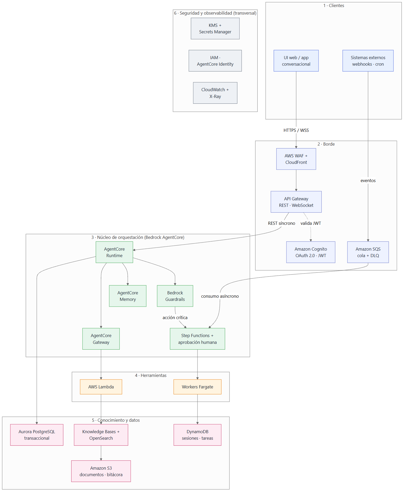

### 8.2 Arquitectura del prototipo implementado

El prototipo materializa la arquitectura con seis servicios. Cada uno es un proceso independiente con su propio puerto y, en el despliegue con Docker, un contenedor propio dentro de la red privada `plataforma`. Solo el API Gateway publica un puerto hacia el exterior (8080). Los demás servicios solo son alcanzables desde la red interna.

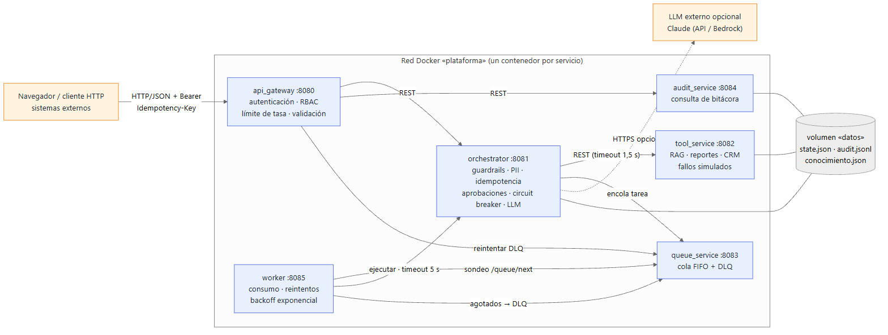

| Servicio del prototipo | Puerto | Equivalente en AWS | Responsabilidad |
|---|---|---|---|
| `api_gateway` | 8080 | API Gateway + Cognito + WAF | Autenticación, roles, límite de tasa, validación, interfaz web |
| `orchestrator` | 8081 | AgentCore Runtime + Guardrails + Step Functions | Guardrails, PII, idempotencia, aprobaciones, circuit breaker, LLM |
| `tool_service` | 8082 | AgentCore Gateway + Lambda + Knowledge Bases | Catálogo de herramientas y búsqueda RAG |
| `queue_service` | 8083 | Amazon SQS + DLQ | Cola FIFO y cola de mensajes fallidos |
| `audit_service` | 8084 | CloudWatch Logs / S3 | Consulta de solo lectura de la bitácora |
| `worker` | 8085 | Workers Fargate / Lambda consumidora | Consumo de la cola, reintentos y envío a DLQ |
| volumen `datos` | — | DynamoDB / Aurora / S3 | Estado, bitácora y base de conocimiento |

### 8.3 Principios de diseño aplicados

- **Desacoplamiento por colas (RNF-01):** las tareas se publican en la cola y el worker las consume sin que el productor espere su ejecución.
- **Estado externalizado (RNF-03):** el orquestador persiste su estado en el volumen compartido y lo recupera al reiniciar.
- **Escalabilidad independiente (RNF-02):** cada servicio es una unidad de despliegue separada.
- **Resiliencia por defecto (RNF-04):** timeouts escalonados, reintentos, DLQ y circuit breaker en las comunicaciones críticas.
- **Seguridad desde el diseño (RNF-06, RNF-10):** autenticación en el borde, mínimo privilegio, usuario no root en los contenedores y enmascaramiento de PII antes de persistir.
- **Mínima superficie expuesta:** un solo puerto publicado; los servicios internos no son accesibles desde fuera de la red Docker.

### 8.4 Mecanismos de comunicación

| Mecanismo | Uso en la arquitectura | Implementación en el prototipo |
|---|---|---|
| REST/HTTP síncrono | Chat, consulta de tareas, aprobaciones, auditoría | Gateway → orquestador → herramientas (`http_json`) |
| Cola de mensajes | Tareas asíncronas, reintentos, DLQ | `queue_service` (`/queue`, `/queue/next`, `/queue/dlt`) |
| Sondeo (polling) | El consumidor extrae trabajo a su ritmo | `worker` consulta `/queue/next` cada 200 ms |
| Eventos | Webhooks y tareas programadas | Campo `evento` en `POST /v1/tareas` |
| HTTPS externo | Llamada al modelo de lenguaje | `llm.py` (Claude vía API o Bedrock, opcional) |
| Almacenamiento compartido | Estado y bitácora | Volumen Docker `datos` |

## 9. Diseño de componentes y comunicación

### 9.1 Componentes y responsabilidades

| Componente | Responsabilidad | RF/RNF que soporta |
|---|---|---|
| API Gateway | Punto de entrada único: autenticación, roles, límite de tasa, validación y enrutamiento | RF-01, RF-11, RNF-06 |
| Orquestador | Coordina el flujo del agente: guardrails, PII, idempotencia, aprobaciones, LLM y estado | RF-01, RF-04, RF-05, RNF-03 |
| Servicio de herramientas | Ejecuta acciones del catálogo y la búsqueda RAG | RF-03, RF-08, RNF-08 |
| Servicio de cola | Almacena tareas pendientes y fallidas (DLQ) | RF-02, RF-07, RNF-01 |
| Worker | Consume la cola, reintenta con backoff y envía a la DLQ | RF-06, RF-07, RNF-04 |
| Servicio de auditoría | Expone la bitácora en modo de solo lectura | RF-09, RNF-07 |
| Adaptador LLM | Genera la respuesta con Claude o en modo simulado, con degradación controlada | RF-01, RF-08 |

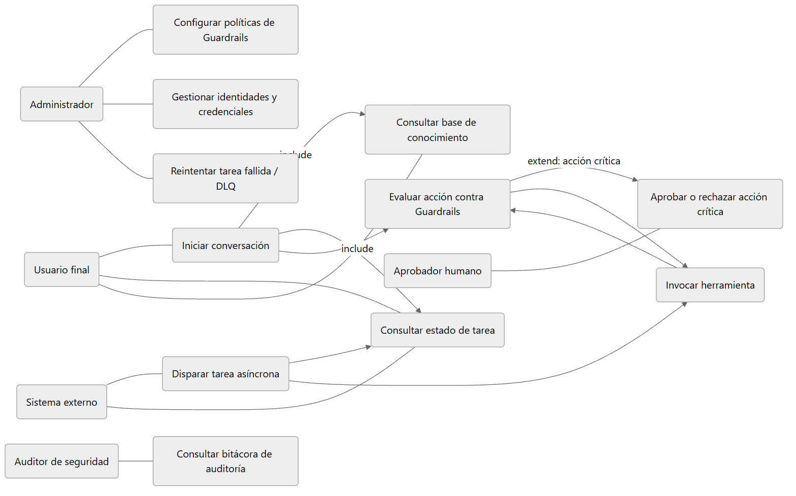

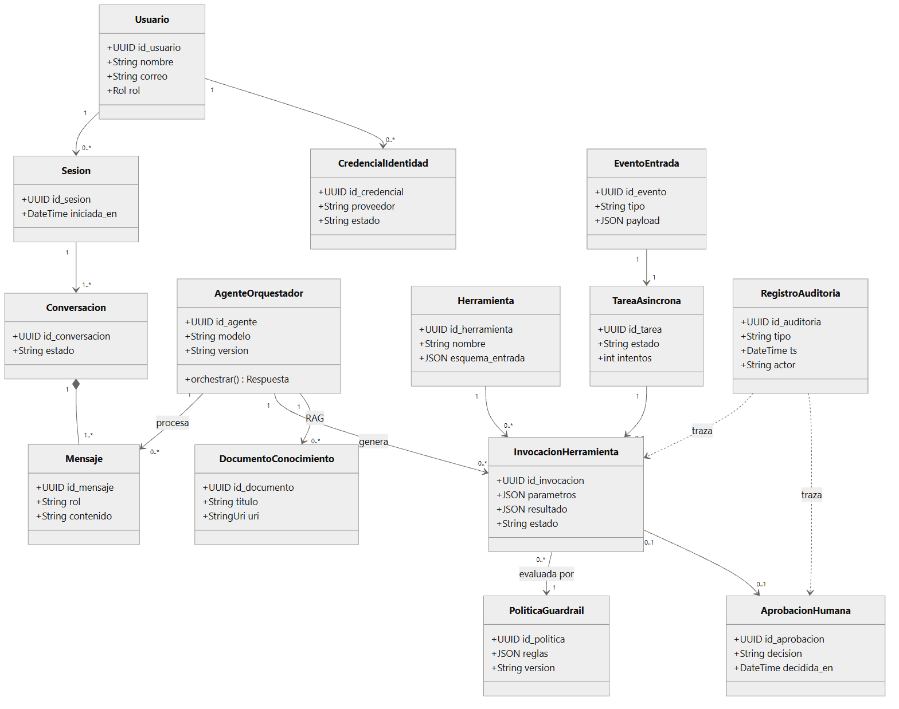

### 9.2 API implementada en el prototipo

Todas las rutas `/v1/*`, salvo `/v1/salud`, exigen `Authorization: Bearer <token>`. Las operaciones de creación aceptan `Idempotency-Key`, y toda respuesta incluye `X-Request-Id`.

| Método | Ruta | Propósito | Roles permitidos | Respuestas |
|---|---|---|---|---|
| GET | `/` | Interfaz web de demostración | Público | 200 |
| GET | `/v1/salud` | Estado de los seis servicios | Público | 200 |
| GET | `/v1/metricas` | Tareas en cola, DLQ, circuit breaker y totales | ADMINISTRADOR, AUDITOR | 200, 401, 403 |
| POST | `/v1/chat` | Enviar mensaje al agente | USUARIO_FINAL, ADMINISTRADOR | 200, 202 (aprobación), 400, 401, 403, 429, 503 |
| POST | `/v1/tareas` | Crear tarea asíncrona | SISTEMA_EXTERNO, ADMINISTRADOR, USUARIO_FINAL | 202, 401, 403 |
| GET | `/v1/tareas/{id}` | Consultar estado de una tarea | USUARIO_FINAL, SISTEMA_EXTERNO, ADMINISTRADOR, AUDITOR | 200, 404 |
| POST | `/v1/aprobaciones/{id}/decidir` | Aprobar o rechazar una acción crítica | APROBADOR, ADMINISTRADOR | 200, 400, 404, 409 |
| POST | `/v1/tareas/reintentar-dlq` | Reintroducir la tarea más antigua de la DLQ | ADMINISTRADOR | 202, 404 |
| GET | `/v1/auditoria?limit=N` | Consultar la bitácora | AUDITOR | 200 |

Rutas internas (solo dentro de la red): `orchestrator` expone `/conversaciones/mensaje`, `/tareas`, `/interno/tareas/ejecutar`, `/interno/tareas/fallido` e `/interno/estado`; `tool_service` expone `/tools/invocar`; `queue_service` expone `/queue`, `/queue/next`, `/queue/dlt` y `/stats`; y todos los servicios exponen `/health`.

### 9.3 API de referencia para el despliegue en AWS

La versión de producción amplía el contrato con recursos REST completos. Las rutas del prototipo se corresponden con estas así: `/v1/chat` equivale a `/v1/conversations/{id}/messages`, `/v1/tareas` a `/v1/tasks` y `/v1/aprobaciones/{id}/decidir` a `/v1/approvals/{id}/decision`.

| Método | Endpoint | Propósito | Rol mínimo |
|---|---|---|---|
| POST | `/oauth/token` | Obtención de token OAuth 2.0/JWT | Público con credenciales |
| POST | `/v1/conversations` | Crear conversación asociada a una sesión | Usuario final |
| POST | `/v1/conversations/{id}/messages` | Enviar mensaje y obtener respuesta | Usuario final |
| GET | `/v1/conversations/{id}` | Consultar historial | Usuario final / Auditor |
| POST | `/v1/tasks` | Registrar tarea asíncrona | Sistema externo |
| GET | `/v1/tasks/{id}` | Consultar estado de tarea | Usuario final / Sistema externo |
| POST | `/v1/tasks/{id}/retry` | Reintentar una tarea específica de la DLQ | Administrador |
| GET · POST | `/v1/tools` | Listar y registrar herramientas | Administrador |
| GET | `/v1/approvals/pending` | Listar aprobaciones pendientes | Aprobador humano |
| POST | `/v1/approvals/{id}/decision` | Aprobar o rechazar acción crítica | Aprobador humano |
| GET · POST | `/v1/guardrails` | Consultar y publicar políticas versionadas | Administrador / Auditor |
| GET | `/v1/audit-logs` | Consultar bitácora de auditoría | Auditor |
| WSS | `/v1/stream` | Streaming de la respuesta del agente | Usuario final |

### 9.4 Autenticación, autorización y matriz de roles

En la arquitectura de referencia, la autenticación usa OAuth 2.0 con Amazon Cognito y JWT firmados, con los flujos *Authorization Code con PKCE* para interfaces interactivas y *Client Credentials* para integraciones máquina a máquina. El autorizador verifica los reclamos `sub`, `role`, `exp`, `iat`, `aud` e `iss` (Hardt, 2012; Jones et al., 2015). El prototipo simplifica este paso con tokens opacos de demostración, cada uno asociado a un sujeto y un rol en `config/config.json`, pero aplica la misma matriz de autorización:

| Rol | Chat | Tareas | Aprobaciones | DLQ | Auditoría |
|---|---|---|---|---|---|
| Usuario final | Escritura | Crear / consultar | — | — | — |
| Sistema externo | — | Crear / consultar | — | — | — |
| Aprobador humano | — | — | Decidir | — | — |
| Administrador | Escritura | Crear / consultar | Decidir | Reintentar | — |
| Auditor | — | Consultar | — | — | Lectura |

### 9.5 Flujo de una solicitud conversacional

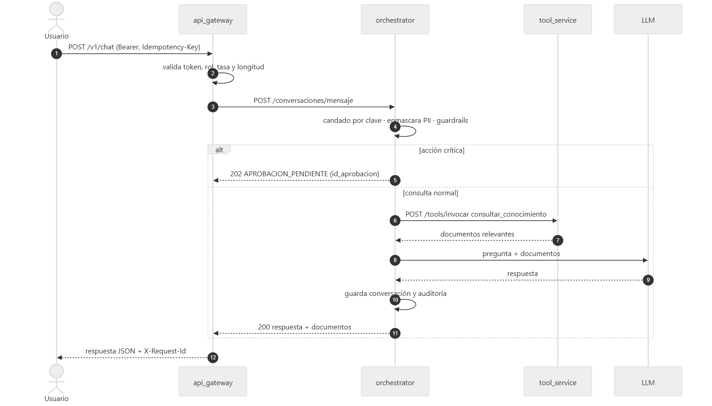

## 10. Desarrollo e implementación

### 10.1 Estrategia de implementación

El prototipo está escrito en Python 3.12 y usa solo la biblioteca estándar (`http.server`, `urllib`, `threading`, `queue`), de modo que cualquier equipo con Python puede ejecutarlo sin instalar dependencias. Cada servicio es un módulo de `src/` que hereda un manejador HTTP común (`JSONHandler`) y se arranca de dos maneras: como proceso local (`scripts/run_all.py`) o como contenedor (`docker compose up`). La configuración (puertos, tokens, límites, reintentos, timeouts y reglas de guardrails) está centralizada en `config/config.json`. Las variables de entorno permiten cambiar los nombres de host al ejecutarse en Docker.

### 10.2 Estructura del repositorio

| Ruta | Contenido |
|---|---|
| `src/common.py` | Cliente HTTP con timeout, servidor multihilo, auditoría, PII y circuit breaker |
| `src/api_gateway.py` · `src/interfaz.html` | Borde: autenticación, roles, límite de tasa, validación e interfaz web |
| `src/orchestrator.py` | Guardrails, idempotencia, aprobaciones, persistencia y coordinación |
| `src/llm.py` | Adaptador del modelo de lenguaje (simulado, Anthropic o Bedrock) |
| `src/tool_service.py` | Catálogo de herramientas y búsqueda RAG |
| `src/queue_service.py` · `src/worker.py` | Cola con DLQ y consumidor con reintentos |
| `src/audit_service.py` | Consulta de la bitácora |
| `tests/` | 25 pruebas automatizadas en cinco archivos |
| `Dockerfile` · `docker-compose.yml` | Imagen y orquestación de los seis contenedores |
| `config/config.json` | Puertos, tokens de demostración, límites y políticas |
| `docs/` | Diagramas Mermaid (`.mmd`) y sus imágenes, capturas de pantalla |
| `evidencias/` | Resultados de pruebas, métricas de rendimiento y demostración en Docker |
| `scripts/` | Arranque local, demostración en Docker y generación de artefactos |

### 10.3 Fragmentos de código relevantes

**a) Autorización y límite de tasa en el borde** (`src/api_gateway.py`):

```python
def _autorizar(handler, roles_permitidos):
    header = handler.headers.get("Authorization", "")
    if not header.startswith("Bearer "):
        handler.send_json(401, {"error": "Token ausente o malformado"})
        return None
    token = header.split(" ", 1)[1].strip()
    claims = _CFG["tokens"].get(token)
    if not claims:
        handler.send_json(401, {"error": "Token inválido"})
        return None
    with _RATE_LOCK:                                   # ventana deslizante de 60 s
        ventanas = _RATE.setdefault(token, [])
        ventanas[:] = [t for t in ventanas if ahora - t < 60]
        if len(ventanas) >= _CFG["seguridad"]["rate_limit_por_minuto"]:
            handler.send_json(429, {"error": "Límite de tasa excedido"})
            return None
        ventanas.append(ahora)
    if claims["role"] not in roles_permitidos:
        handler.send_json(403, {"error": "Rol no autorizado para esta operación"})
        return None
    return claims
```

**b) Idempotencia segura ante concurrencia** (`src/orchestrator.py`). Un candado por `Idempotency-Key` serializa las solicitudes duplicadas, y la segunda encuentra la respuesta que guardó la primera:

```python
def _candado_clave(clave: str):
    if not clave:
        return contextlib.nullcontext()
    with _CANDADOS_GUARDA:
        return _CANDADOS_CLAVE.setdefault(clave, threading.Lock())

# en do_POST:
with _candado_clave(body.get("idempotency_key", "")):
    self._crear_tarea(body)   # consulta el mapa de idempotencia y, si no existe, crea
```

**c) Reintentos con backoff exponencial y DLQ** (`src/worker.py`):

```python
for intento in range(1, _MAX + 1):
    status, respuesta = http_json("POST", service_url("orchestrator", "/interno/tareas/ejecutar"),
                                  {"id_tarea": tarea_id, "intento": intento, "payload": payload},
                                  timeout=_CFG["timeouts_segundos"]["worker_a_orquestador"])
    if status == 200:
        return {"estado": "COMPLETADA", "intentos": intento}
    if intento < _MAX:
        time.sleep(_BASE * (2 ** (intento - 1)))      # 0,05 s · 0,10 s
http_json("POST", service_url("orchestrator", "/interno/tareas/fallido"), {"id_tarea": tarea_id})
http_json("POST", service_url("queue_service", "/queue/dlt"), tarea)
```

**d) Circuit breaker** (`src/common.py`):

```python
def permite(self) -> bool:
    with self._lock:
        if self.estado == "ABIERTO":
            if time.monotonic() - self.abierto_desde >= self.apertura:
                self.estado = "SEMIABIERTO"            # deja pasar una llamada de sondeo
                return True
            return False
        return True

def fallo(self) -> None:
    with self._lock:
        self.fallos += 1
        if self.fallos >= self.umbral:
            self.estado = "ABIERTO"
            self.abierto_desde = time.monotonic()
```

**e) Adaptador LLM con degradación controlada** (`src/llm.py`):

```python
def generar_respuesta(consulta, documentos):
    proveedor = os.environ.get("LLM_PROVIDER", "simulado").lower()
    if proveedor in {"anthropic", "bedrock"}:
        try:
            texto = (_anthropic if proveedor == "anthropic" else _bedrock)(consulta, documentos)
            if texto:
                return texto, proveedor
        except Exception as exc:                       # sin red, sin credenciales, rechazo
            return _simulado(consulta, documentos), f"simulado (fallback: {type(exc).__name__})"
    return _simulado(consulta, documentos), "simulado"
```

**f) Persistencia diferida del estado (write-behind)** (`src/orchestrator.py`). Cada operación marca el estado como modificado, y un hilo lo vuelca a disco como máximo cada 100 ms en lugar de reescribirlo dos veces por solicitud:

```python
def _persist() -> None:
    _SUCIO.set()

def _persistidor() -> None:
    while True:
        _SUCIO.wait()
        time.sleep(_PERSIST_INTERVALO)                 # 0,1 s
        _SUCIO.clear()
        _volcar_estado()                               # escritura atómica: temporal + os.replace
```

**g) Despliegue en contenedores** (`docker-compose.yml`, extracto):

```yaml
x-servicio: &servicio
  build: .
  restart: unless-stopped
  networks: [plataforma]
  volumes: [datos:/app/data]
  healthcheck:
    test: ["CMD", "python", "-c", "...urlopen('http://127.0.0.1:'+PUERTO+'/health')..."]
    interval: 5s
services:
  orchestrator:
    <<: *servicio
    command: ["python", "src/orchestrator.py"]
    depends_on:
      tool_service: { condition: service_healthy }
  api_gateway:
    <<: *servicio
    command: ["python", "src/api_gateway.py"]
    ports: ["8080:8080"]          # único puerto publicado
```

### 10.4 Evidencias de las funcionalidades

La interfaz web (`http://127.0.0.1:8080/`) es una consola de operación con un menú lateral y seis vistas: **Resumen** (indicadores, topología en vivo y actividad reciente), **Agente** (conversación con citas de las fuentes), **Tareas** (eventos asíncronos con el detalle de cada intento), **Aprobaciones** (acciones críticas en espera), **Servicios** (salud de cada contenedor) y **Bitácora**. Los indicadores de cola, DLQ y circuit breaker se obtienen de `GET /v1/metricas`, y el estado de los servicios de `GET /v1/salud`. El gateway calcula ese estado con un hilo de vigilancia por servicio, de modo que responde al instante aunque un contenedor esté caído.

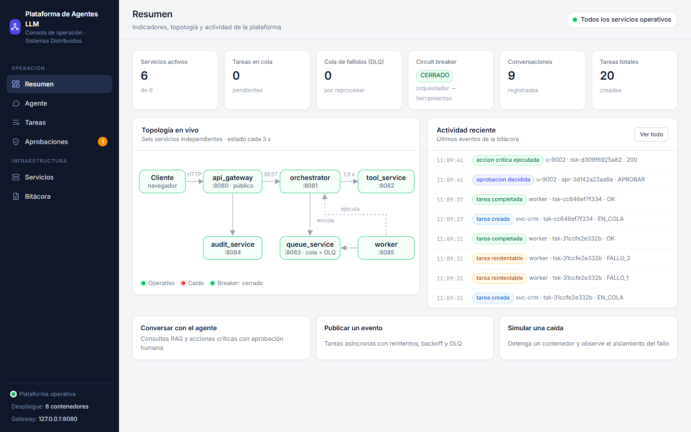

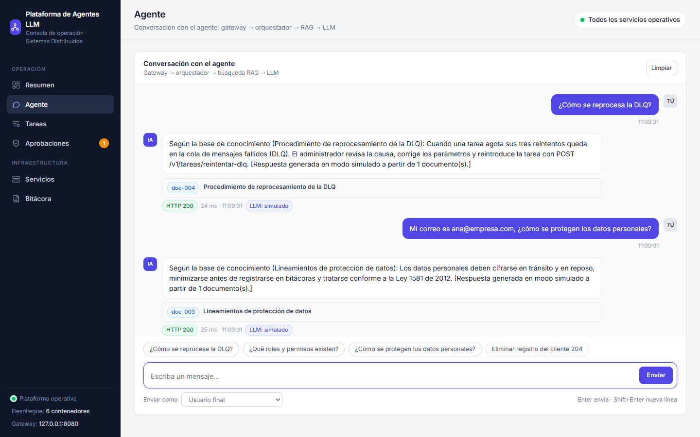

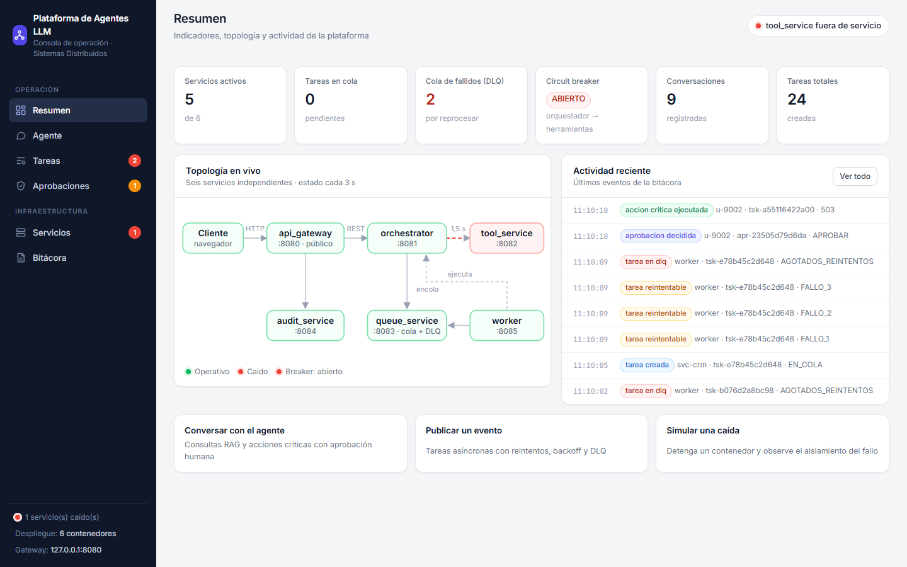

## 11. Tolerancia a fallos y recuperación

### 11.1 Riesgos considerados

Los fallos contemplados son: indisponibilidad temporal o total de una herramienta, duplicidad de mensajes por reintentos de red, interrupción de un servicio, agotamiento de reintentos, indisponibilidad del proveedor del LLM y condiciones de carrera entre solicitudes concurrentes. Cada riesgo tiene un mecanismo asociado, y todos los mecanismos se verifican con pruebas automatizadas.

### 11.2 Mecanismos implementados

| Mecanismo | Descripción | Implementación en AWS | Prototipo (verificado) |
|---|---|---|---|
| Timeouts escalonados | El borde espera más que los servicios internos, para que el error lo reporte quien lo detecta | Timeouts de API Gateway y del SDK | Gateway 30 s · worker 5 s · orquestador → herramienta 1,5 s |
| Reintentos con backoff | 3 intentos con espera exponencial | `Retry` de Step Functions con `BackoffRate` | `worker.py`: 0,05 s y 0,10 s |
| Idempotencia | Una misma `Idempotency-Key` produce un solo efecto, incluso en paralelo | Escrituras condicionales en DynamoDB | Candado por clave + mapa persistido |
| DLQ | Cola de mensajes fallidos tras agotar los reintentos | SQS DLQ + alarma de CloudWatch | `/queue/dlt` |
| Circuit breaker | Deja de llamar a una dependencia que falla repetidamente | Patrón en el cliente de herramientas | Umbral 3 fallos, apertura 1 s |
| Degradación controlada | Si el LLM falla, se responde en modo extractivo | Modelo alternativo / respuesta en caché | `llm.py` → `simulado (fallback)` |
| Verificación de salud | Cada servicio expone `/health` | Health checks de ECS / Route 53 | `healthcheck` de Compose y `/v1/salud` |
| Reinicio automático | Un contenedor caído se vuelve a levantar | ECS service scheduler | `restart: unless-stopped` |
| Recuperación desde la DLQ | El administrador reprocesa tras corregir la causa | `POST /v1/tasks/{id}/retry` | `POST /v1/tareas/reintentar-dlq` |
| Estado persistente | El estado sobrevive al reinicio del orquestador | DynamoDB / Aurora multi-AZ | `state.json` en el volumen `datos` |
| Redundancia geográfica | Réplicas en varias zonas de disponibilidad | Multi-AZ, copias de seguridad | Solo en diseño |

### 11.3 Secuencia de recuperación

Cuando la herramienta no responde, el orquestador agota su timeout de 1,5 s y devuelve un 503 controlado. El worker registra el evento `tarea_reintentable`, espera el backoff y vuelve a intentar. Tras tres fallos, el circuit breaker del orquestador pasa a ABIERTO y las llamadas siguientes se rechazan de inmediato, sin esperar el timeout. El worker marca la tarea como `FALLIDA`, la publica en la DLQ y registra `tarea_en_dlq`. Cuando el servicio se recupera, el administrador reintroduce la tarea. La primera llamada pasa con el breaker en SEMIABIERTO y, si tiene éxito, el breaker vuelve a CERRADO. Durante todo el episodio, el gateway, la cola, el worker y la auditoría siguen respondiendo: el fallo queda aislado.

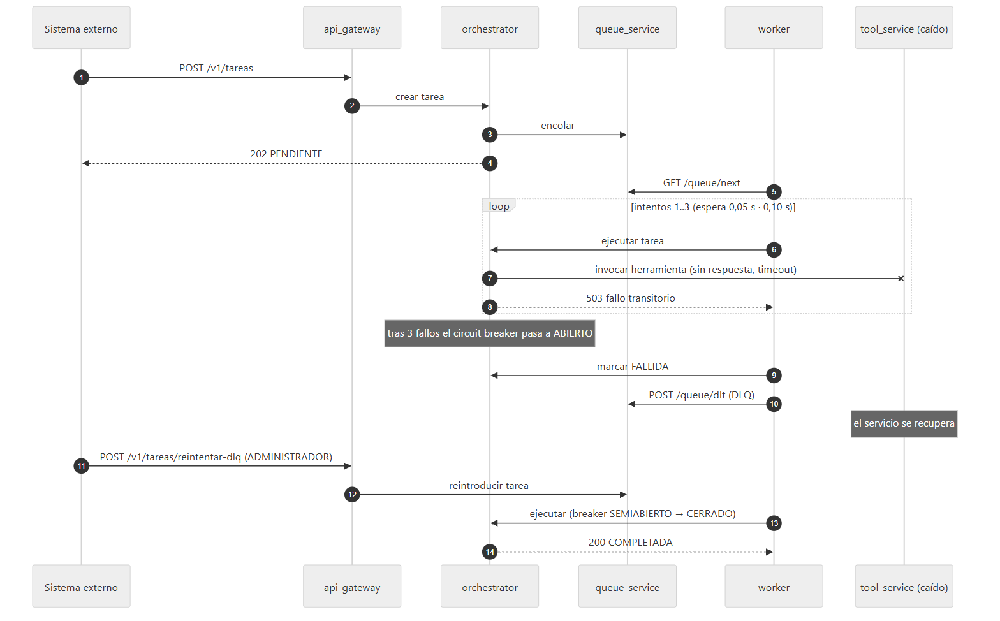

## 12. Seguridad del sistema

### 12.1 Autenticación y autorización

Toda ruta de negocio exige un token. El gateway responde 401 si el token falta o es inválido, 403 si el rol no tiene permiso para la operación y 429 si el token supera 120 solicitudes por minuto. Las tres respuestas están cubiertas por pruebas. En producción, los tokens opacos de demostración se sustituyen por JWT emitidos por Cognito y verificados en el autorizador del API Gateway.

### 12.2 Protección de la información y de las interfaces

| Medida | Prototipo | Arquitectura AWS |
|---|---|---|
| Validación de entradas | Mensaje no vacío y ≤ 2.000 caracteres (400); decisión solo APROBAR/RECHAZAR | WAF con reglas contra inyección y XSS |
| Límite de tasa | Ventana deslizante de 120 solicitudes/min por token | WAF rate-based rules y planes de uso de API Gateway |
| Enmascaramiento de PII | Correos y números de 10 dígitos se reemplazan por `[PII_ENMASCARADO]` antes de registrarse | Bedrock Guardrails (filtros de PII) |
| Superficie expuesta | Solo el puerto 8080 se publica; los demás servicios están en una red Docker privada | Subredes privadas y VPC endpoints |
| Mínimo privilegio | Contenedores ejecutados con un usuario sin privilegios (`app`) | Roles IAM por función y por agente |
| Cifrado en tránsito | HTTP local (fuera de alcance del prototipo) | TLS 1.2+ con certificados de ACM |
| Cifrado en reposo | No aplica (datos de demostración) | KMS para DynamoDB, Aurora, S3 y OpenSearch |
| Secretos | La clave del LLM solo llega por variable de entorno, nunca se escribe en archivos | Secrets Manager |
| Trazabilidad | Bitácora append-only con actor, entidad, resultado y hora | CloudWatch Logs y S3 con bloqueo de objetos |
| Acciones críticas | Guardrails detectan "eliminar registro", "transferir datos" y "enviar correo masivo" y exigen aprobación | Bedrock Guardrails + Step Functions |

### 12.3 Cumplimiento normativo

El diseño observa los principios de finalidad, libertad, seguridad, y acceso y circulación restringida de la Ley 1581 de 2012 y su Decreto 1377 de 2013, además del Modelo de Seguridad y Privacidad de la Información (MSPI) del MinTIC (Ministerio de Tecnologías de la Información y las Comunicaciones, 2016). Cada dato personal es trazable a un identificador de usuario, lo que permite atender solicitudes de consulta, rectificación y supresión. Antes de operar con datos reales deben formalizarse la Política de Tratamiento de Datos Personales, el registro ante el RNBD de la Superintendencia de Industria y Comercio y la evaluación de la transferencia internacional de datos al proveedor del LLM.

## 13. Pruebas y evaluación

### 13.1 Plan de pruebas

| Tipo | Archivo | Casos | Objetivo | Criterio de aceptación |
|---|---|---|---|---|
| Funcionales | `test_funcionales.py` | 11 | Operaciones principales, control de acceso, validación, PII y aprobación | Respuestas y códigos HTTP esperados |
| Integración | `test_integracion.py` | 4 | Comunicación gateway → orquestador → cola → worker → herramienta y RAG | Flujo extremo a extremo sin errores |
| Concurrencia | `test_concurrencia.py` | 3 | Solicitudes simultáneas y duplicadas | 0 errores; identificadores únicos; 1 efecto por clave |
| Rendimiento | `test_rendimiento.py` | 1 | 250 solicitudes de chat con 25 clientes concurrentes | 0 errores y p95 ≤ 500 ms (RNF-09) |
| Tolerancia a fallos | `test_tolerancia_fallos.py` | 6 | Reintentos, DLQ, recuperación, idempotencia, circuit breaker y caída real de un proceso | Aislamiento y recuperación correctos |

Además de las pruebas automatizadas, `scripts/demo_docker.py` repite el escenario de caída sobre el despliegue en contenedores: detiene el contenedor `tool_service` con `docker compose stop` y lo vuelve a iniciar.

### 13.2 Resultados

La ejecución de `python -m unittest discover -s tests -v` terminó con **25 pruebas correctas (OK) en 31 segundos**. La salida completa está en `evidencias/resultados_pruebas.txt`.

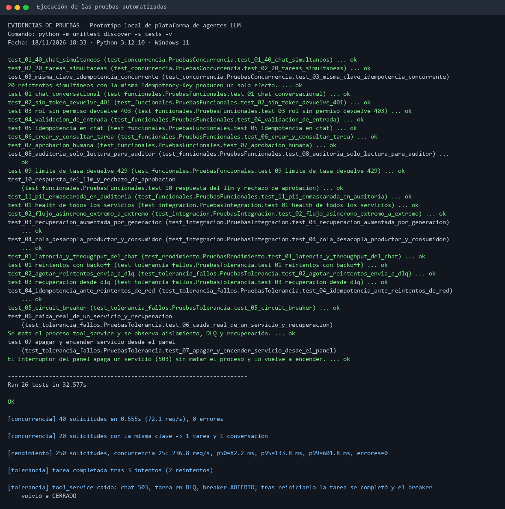

Los hallazgos más relevantes son:

- **Concurrencia.** Cuarenta chats simultáneos se completaron sin errores, con 40 conversaciones y 40 eventos de auditoría distintos. Veinte creaciones de tarea en paralelo produjeron 20 identificadores únicos y 20 mensajes en cola. Veinte solicitudes simultáneas con la misma `Idempotency-Key` produjeron **una sola tarea y una sola conversación**; antes de la corrección, el mismo escenario creaba 7 tareas y 16 conversaciones.
- **Tolerancia a fallos.** Una tarea con dos fallos transitorios se completó en el tercer intento. Con un fallo persistente, la tarea agotó sus tres intentos y pasó a la DLQ, desde donde se reprocesó con éxito. Al **matar el proceso real** de `tool_service`, los otros cinco servicios siguieron respondiendo, el chat devolvió 503 controlado, la tarea llegó a la DLQ y el circuit breaker se abrió. Tras reiniciar el servicio, la tarea se completó y el breaker volvió a CERRADO.
- **Seguridad.** Se verificaron las respuestas 401, 403, 400 y 429, el rechazo (409) de una segunda decisión sobre la misma aprobación, y que ningún correo ni número telefónico aparece en claro en la bitácora.
- **Contenedores.** En Docker, el flujo completo funcionó entre contenedores. Con `tool_service` detenido, el chat respondió 503, la cola siguió aceptando tareas (202), la tarea terminó en la DLQ y, al reiniciar el contenedor, se reprocesó hasta COMPLETADA (`evidencias/docker_demo.txt`).

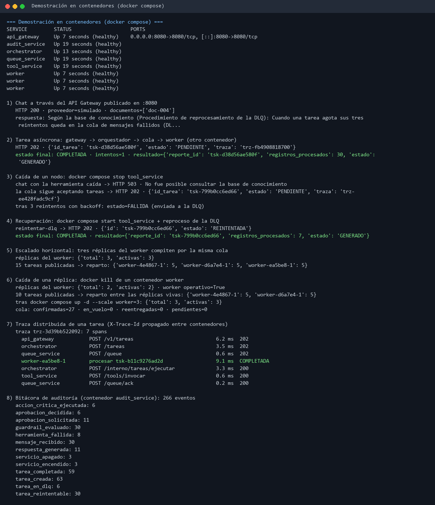

### 13.3 Rendimiento: medición, diagnóstico y optimización

La primera medición incumplió el requisito RNF-09. El diagnóstico mostró que el orquestador reescribía el archivo de estado completo dos veces por solicitud mientras sostenía el candado global, de modo que las solicitudes se serializaban y el costo crecía con el tamaño del estado. Al cambiar a persistencia diferida (fragmento 10.3 f), el p95 bajó de 576 ms a 130 ms y el throughput se multiplicó por 3,7:

| Métrica (250 solicitudes, 25 concurrentes) | Antes | Después | Requisito |
|---|---:|---:|---:|
| Throughput | 69,4 req/s | 254,9 req/s | — |
| Latencia media | 339,1 ms | 95,0 ms | — |
| p50 | 402,4 ms | 83,0 ms | — |
| p95 | 576,5 ms | 130,4 ms | ≤ 500 ms |
| p99 | 750,2 ms | 598,2 ms | — |
| Errores | 0 | 0 | 0 |
| Cumple RNF-09 | No | **Sí** | — |

El p99 se mantiene alto porque unas pocas solicitudes coinciden con el volcado del estado a disco o con la planificación de hilos del sistema operativo. Este fenómeno de "cola larga" es típico de los sistemas distribuidos (Dean & Barroso, 2013). La mejora tiene un costo: ante una caída abrupta del orquestador pueden perderse hasta 100 ms de cambios de estado, un compromiso aceptable para un prototipo que en producción se resolvería con escrituras transaccionales en DynamoDB. Los valores varían entre ejecuciones en un mismo equipo de escritorio: en tres corridas posteriores a la optimización, el p95 fue de 81 ms, 130 ms y 248 ms. Las tres cumplen el requisito; la tabla reporta la corrida guardada en las evidencias. Las métricas exactas de cada corrida se guardan en `evidencias/rendimiento.json` y `evidencias/rendimiento_antes_optimizacion.json`.

### 13.4 Comparación con los requisitos

| Requisito | Evidencia | Estado |
|---|---|---|
| RF-01, RF-08 | Chat con RAG (funcionales 01, 10; integración 03) | Cumplido |
| RF-02, RF-06 | Creación y consulta de tareas (funcionales 06; integración 02, 04) | Cumplido |
| RF-03 | Invocación de herramientas desde orquestador y worker | Cumplido |
| RF-04, RF-05 | Guardrails, aprobación y rechazo (funcionales 07, 10) | Cumplido |
| RF-07 | Reintentos, DLQ y reproceso (tolerancia 01–03, 06) | Cumplido |
| RF-09 | Bitácora consultable por el auditor (funcionales 08, 11) | Cumplido |
| RF-10, RF-11 | Tokens con rol, 401/403/429 (funcionales 02, 03, 09) | Cumplido con tokens de demostración (sin OAuth real) |
| RF-12 | Versionado de políticas | Diseñado; no implementado |
| RNF-01, RNF-04 | La cola acepta tareas con la herramienta caída; fallo aislado (tolerancia 06, demo Docker) | Cumplido |
| RNF-02 | Seis servicios desplegables por separado | Cumplido en estructura; escalado horizontal no probado |
| RNF-03 | Estado en volumen persistente | Cumplido |
| RNF-05 | Reinicio automático y healthchecks | Cumplido en Docker; multi-AZ solo en diseño |
| RNF-06 | Cifrado TLS/KMS | Diseñado; no aplica al prototipo local |
| RNF-07 | Evento de auditoría por acción | Cumplido (sin trazas distribuidas tipo X-Ray) |
| RNF-08 | Herramientas en servicio separado | Cumplido |
| RNF-09 | p95 = 130 ms ≤ 500 ms | Cumplido tras optimización |
| RNF-10 | PII enmascarada (funcionales 11) | Cumplido en lo técnico |

## 14. Despliegue y ejecución

### 14.1 Requisitos de software y hardware

| Elemento | Requisito |
|---|---|
| Sistema operativo | Windows 10/11, Linux o macOS |
| Python | 3.12 o superior (solo para ejecución local y pruebas) |
| Docker | Docker Desktop o Docker Engine 24+ con Compose v2 (para el despliegue en contenedores) |
| Hardware | 2 núcleos, 4 GB de RAM (8 GB recomendados con Docker) |
| Opcional | `pip install anthropic` y una clave de API para usar Claude como LLM real |

### 14.2 Puertos y variables de configuración

| Servicio | Puerto | Expuesto en Docker |
|---|---|---|
| api_gateway (e interfaz web) | 8080 | Sí |
| orchestrator | 8081 | No |
| tool_service | 8082 | No |
| queue_service | 8083 | No |
| audit_service | 8084 | No |
| worker | 8085 | No |

| Variable | Valor por defecto | Efecto |
|---|---|---|
| `LLM_PROVIDER` | `simulado` | `simulado`, `anthropic` o `bedrock` |
| `ANTHROPIC_API_KEY` | — | Clave para `LLM_PROVIDER=anthropic` |
| `LLM_MODEL` | `claude-opus-5-5` | Modelo de Claude a usar |
| `AWS_REGION` | `us-east-1` | Región de Bedrock para `LLM_PROVIDER=bedrock` |
| `WORKER_POLL` | `1` (run_all, Docker) · `0` (pruebas) | Activa el consumo automático de la cola |
| `BIND_HOST` | `127.0.0.1` | En Docker vale `0.0.0.0` para aceptar conexiones de otros contenedores |
| `<SERVICIO>_HOST` | `127.0.0.1` | En Docker apunta al nombre del contenedor (p. ej. `ORCHESTRATOR_HOST=orchestrator`) |

### 14.3 Ejecución con Docker (recomendada)

```bash
git clone https://github.com/felipearenas256-dot/proyecto-sd-plataforma-agentes-llm.git
cd proyecto-sd-plataforma-agentes-llm
docker compose up -d --build --wait     # construye la imagen y levanta los 6 contenedores
docker compose ps                        # todos deben aparecer como (healthy)
# Interfaz: http://127.0.0.1:8080/
python scripts/demo_docker.py            # recorrido con caída y recuperación de un nodo
docker compose down -v                   # detiene y borra contenedores y volumen
```

Para usar Claude como LLM real: `INSTALAR_ANTHROPIC=1 LLM_PROVIDER=anthropic ANTHROPIC_API_KEY=<clave> docker compose up -d --build`.

### 14.4 Ejecución local sin Docker

```bash
python scripts/run_all.py                 # inicia los 6 procesos y espera a /health
python -m unittest discover -s tests -v   # en otra terminal, con run_all detenido*
python scripts/run_all.py --stop
```

\* Las pruebas levantan sus propios procesos con el worker en modo manual; deben ejecutarse sin `run_all.py` ni Docker en marcha, porque usan los mismos puertos.

### 14.5 Plan de despliegue en AWS

1. Aprovisionar con IaC (AWS CDK o Terraform) una VPC con subredes privadas en al menos dos zonas de disponibilidad y los roles IAM de mínimo privilegio.
2. Crear el grupo de usuarios de Cognito, el autorizador JWT y el API Gateway REST/WebSocket, protegidos por WAF y CloudFront.
3. Desplegar la cola SQS con su DLQ, las Lambdas de herramientas y los workers en Fargate, a partir de la misma imagen de contenedor del prototipo.
4. Configurar AgentCore Runtime, Memory, Gateway y Guardrails, y Step Functions con políticas `Retry`/`Catch`.
5. Aprovisionar DynamoDB, Aurora, OpenSearch Serverless y S3 con cifrado KMS.
6. Configurar CloudWatch, X-Ray, alarmas sobre la profundidad de la DLQ y tableros de latencia p95.
7. Ejecutar pruebas de carga y habilitar el despliegue multirregión según el plan de continuidad.

## 15. Resultados y análisis

### 15.1 Logros

Se completó el ciclo exigido por la guía: levantamiento de 12 requisitos funcionales y 10 no funcionales verificables, arquitectura de referencia sobre AWS, siete diagramas (arquitectura de referencia, arquitectura del prototipo, casos de uso, clases, modelo de datos y dos de secuencia), y un prototipo de seis servicios que se ejecuta tanto en procesos locales como en contenedores. Además, 25 pruebas automatizadas cubren las cinco categorías recomendadas. El prototipo demuestra los conceptos centrales de la asignatura con evidencias reproducibles: comunicación síncrona y asíncrona, concurrencia con sincronización, tolerancia a fallos con aislamiento real de un nodo caído, seguridad en el borde y despliegue en contenedores.

### 15.2 Dificultades encontradas

Las pruebas destaparon defectos reales de los sistemas distribuidos, que se corrigieron y se documentan como aprendizajes:

1. **Condición de carrera en la idempotencia.** La verificación "¿existe ya esta clave?" y la creación se hacían en dos secciones críticas separadas. Veinte reintentos simultáneos con la misma clave crearon 7 tareas y 16 conversaciones. Se corrigió con un candado por clave, y la prueba `test_03_misma_clave_idempotencia_concurrente` evita que vuelva a ocurrir.
2. **Bitácora corrompida bajo carga.** Varios hilos escribían en `audit.jsonl` a la vez y las líneas se intercalaban, de modo que la consulta del auditor fallaba. Se añadió un candado de escritura y una lectura tolerante a líneas incompletas.
3. **Cuello de botella de persistencia.** El p95 inicial de 576 ms incumplía el RNF-09; la persistencia diferida lo redujo a 130 ms (sección 13.3).
4. **Timeouts mal escalonados en Docker.** Con un contenedor detenido, la resolución del nombre tardaba más que el timeout del gateway, y el error se reportaba en el borde y no en el orquestador. Se definieron timeouts decrecientes hacia el interior (30 s, 5 s y 1,5 s).
5. **Búsqueda RAG poco efectiva.** La búsqueda inicial comparaba la pregunta completa como texto literal y casi nunca encontraba coincidencias. Se reemplazó por coincidencia de términos normalizados sin tildes y con raíces de seis letras.
6. **Chequeo de salud lento con un nodo caído.** Con un contenedor detenido, la resolución DNS de su nombre tardaba de 3 a 4 segundos sin respetar el timeout HTTP, y el panel se congelaba. Se cambió a un hilo de vigilancia por servicio que guarda el último estado; `/v1/salud` pasó a responder en unos 3 ms.

### 15.3 Limitaciones

- La autenticación usa tokens estáticos de demostración y no un proveedor OAuth real con JWT firmados.
- La cola vive en la memoria del `queue_service`: si ese contenedor se reinicia, las tareas pendientes se pierden. SQS resolvería esta limitación en producción.
- El circuit breaker y el límite de tasa son locales a cada proceso; con varias réplicas necesitarían un almacén compartido, como ElastiCache.
- El estado compartido en un volumen Docker no escala a varios nodos físicos; en producción corresponde a DynamoDB o Aurora.
- No se implementaron trazas distribuidas (X-Ray/OpenTelemetry), ni el streaming por WebSocket, ni el versionado de políticas (RF-12).
- Por defecto, el LLM funciona en modo simulado (respuesta extractiva). La integración con Claude está implementada, pero no se validó con credenciales reales durante las pruebas para mantenerlas reproducibles y sin costo.
- No se desplegó en AWS, de modo que la disponibilidad multi-AZ y el rendimiento en la nube no están medidos.

## 16. Presupuesto

### 16.1 Supuestos

Valores en pesos colombianos (COP), con una tasa de referencia de 1 USD ≈ 4.000 COP. El costo del tiempo de desarrollo se valora a una tarifa de referencia de practicante de ingeniería y no representa un desembolso. Los costos de AWS son estimaciones de planeación que deben confirmarse con la AWS Pricing Calculator antes de cualquier despliegue.

### 16.2 Escenario A · Costo real del proyecto entregado (prototipo)

| Ítem | Detalle | Cantidad | Valor unitario (COP) | Subtotal (COP) |
|---|---|---:|---:|---:|
| Desarrollo y documentación | 2 integrantes × 60 h | 120 h | $55.000 | $6.600.000 |
| Infraestructura | Equipos personales; Docker Desktop (licencia gratuita para uso personal y educativo) | — | $0 | $0 |
| Software y licencias | Python, Docker, VS Code, Git, GitHub, Mermaid (gratuitos) | — | $0 | $0 |
| Modelo de lenguaje | Modo simulado; opcionalmente ~1.000 consultas a Claude para pruebas (~USD 5) | 1 | $20.000 | $20.000 |
| Materiales | Impresión, diagramas y grabación del video | 1 | $150.000 | $150.000 |
| **Subtotal** | | | | **$6.770.000** |
| Contingencia | 10 % | | | $677.000 |
| **Total escenario A** | | | | **$7.447.000** |

El desembolso efectivo del escenario A es de $170.000 (LLM opcional y materiales); el resto corresponde al valor del tiempo invertido.

### 16.3 Escenario B · Entorno de desarrollo y pruebas en AWS (3 meses)

| Ítem | Detalle | Mensual (COP) | 3 meses (COP) |
|---|---|---:|---:|
| Cómputo y borde | API Gateway, Lambda, SQS, Step Functions (mayormente nivel gratuito) y Fargate | $120.000 | $360.000 |
| Bedrock (LLM) | Consumo de tokens en pruebas | $120.000 | $360.000 |
| Datos | DynamoDB bajo demanda, Aurora Serverless v2 mínimo, S3 | $160.000 | $480.000 |
| Búsqueda vectorial | OpenSearch Serverless (mínimo de capacidad) o pgvector en Aurora como alternativa económica | $50.000 | $150.000 |
| Seguridad y monitoreo | WAF, KMS, CloudWatch, X-Ray | $40.000 | $120.000 |
| **Subtotal infraestructura** | | **$490.000** | **$1.470.000** |

| Concepto | Valor (COP) |
|---|---:|
| Escenario A (desarrollo, materiales y LLM de pruebas) | $6.770.000 |
| Infraestructura AWS (3 meses) | $1.470.000 |
| Contingencia 10 % | $824.000 |
| **Total escenario B** | **$9.064.000** |

En producción, el costo dominante es el consumo de tokens del LLM, que crece con el número de conversaciones. Se recomienda configurar AWS Budgets con alarmas al 50 %, 80 % y 100 % del presupuesto mensual antes del primer despliegue.

## 17. Conclusiones

1. El objetivo general se cumplió: se diseñó una arquitectura distribuida de referencia sobre AWS y se desarrolló, implementó y desplegó en contenedores un prototipo de seis servicios que la materializa, con documentación, pruebas y presupuesto.
2. La separación en servicios autónomos aisló los fallos en la práctica, no solo en el papel. Al matar el proceso o detener el contenedor de herramientas, los otros cinco servicios siguieron respondiendo, las tareas se conservaron en la cola y la DLQ, y el sistema se recuperó sin intervención sobre los demás componentes.
3. Los mecanismos de tolerancia a fallos se complementan entre sí: los timeouts detectan el fallo, los reintentos absorben los transitorios, el circuit breaker evita insistir sobre una dependencia caída, la DLQ conserva lo que no pudo procesarse y la idempotencia hace seguros los reintentos.
4. La concurrencia fue la fuente principal de defectos. Las dos condiciones de carrera encontradas solo aparecieron bajo carga paralela, lo que confirma que las pruebas de concurrencia son indispensables en un sistema distribuido y que la idempotencia debe garantizarse de forma atómica.
5. Medir antes de optimizar fue decisivo: la prueba de rendimiento detectó el incumplimiento de RNF-09, el diagnóstico encontró la causa y la corrección mejoró el throughput 3,7 veces, con un compromiso explícito entre latencia y durabilidad.
6. La principal limitación es que el prototipo no reemplaza los servicios administrados: la cola en memoria, los tokens estáticos y el estado en un volumen local deben sustituirse por SQS, Cognito y DynamoDB. Como trabajo futuro se propone desplegar la arquitectura en AWS con IaC, incorporar trazas distribuidas con OpenTelemetry, validar el LLM real con pruebas de carga y formalizar la política de tratamiento de datos personales.

## 18. Referencias bibliográficas

Amazon Web Services. (s. f.-a). *AWS Well-Architected Framework*. Recuperado el 17 de noviembre de 2026, de https://docs.aws.amazon.com/wellarchitected/latest/framework/welcome.html

Amazon Web Services. (s. f.-b). *Amazon Bedrock AgentCore developer guide*. Recuperado el 17 de noviembre de 2026, de https://docs.aws.amazon.com/bedrock-agentcore/latest/devguide/what-is-bedrock-agentcore.html

Armbrust, M., Fox, A., Griffith, R., Joseph, A. D., Katz, R., Konwinski, A., Lee, G., Patterson, D., Rabkin, A., Stoica, I., & Zaharia, M. (2010). A view of cloud computing. *Communications of the ACM, 53*(4), 50–58. https://doi.org/10.1145/1721654.1721672

Congreso de la República de Colombia. (2012, 17 de octubre). *Ley 1581 de 2012, por la cual se dictan disposiciones generales para la protección de datos personales*. https://www.funcionpublica.gov.co/eva/gestornormativo/norma.php?i=49981

Coulouris, G., Dollimore, J., Kindberg, T., & Blair, G. (2012). *Distributed systems: Concepts and design* (5.ª ed.). Pearson.

Dean, J., & Barroso, L. A. (2013). The tail at scale. *Communications of the ACM, 56*(2), 74–80. https://doi.org/10.1145/2408776.2408794

Fielding, R. T. (2000). *Architectural styles and the design of network-based software architectures* [Tesis doctoral, University of California, Irvine]. https://ics.uci.edu/~fielding/pubs/dissertation/top.htm

Hardt, D. (Ed.). (2012). *The OAuth 2.0 authorization framework* (RFC 6749). Internet Engineering Task Force. https://doi.org/10.17487/RFC6749

Jones, M., Bradley, J., & Sakimura, N. (2015). *JSON Web Token (JWT)* (RFC 7519). Internet Engineering Task Force. https://doi.org/10.17487/RFC7519

Kleppmann, M. (2017). *Designing data-intensive applications: The big ideas behind reliable, scalable, and maintainable systems*. O'Reilly Media.

Lewis, J., & Fowler, M. (2014, 25 de marzo). *Microservices: A definition of this new architectural term*. martinfowler.com. https://martinfowler.com/articles/microservices.html

Lewis, P., Perez, E., Piktus, A., Petroni, F., Karpukhin, V., Goyal, N., Küttler, H., Lewis, M., Yih, W., Rocktäschel, T., Riedel, S., & Kiela, D. (2020). Retrieval-augmented generation for knowledge-intensive NLP tasks. *Advances in Neural Information Processing Systems, 33*, 9459–9474.

Merkel, D. (2014). Docker: Lightweight Linux containers for consistent development and deployment. *Linux Journal, 2014*(239), Artículo 2.

Ministerio de Tecnologías de la Información y las Comunicaciones. (2016). *Modelo de seguridad y privacidad de la información*. MinTIC. https://www.mintic.gov.co/gestionti/615/articles-5482_Modelo_de_Seguridad_Privacidad.pdf

Newman, S. (2021). *Building microservices: Designing fine-grained systems* (2.ª ed.). O'Reilly Media.

Nygard, M. T. (2018). *Release it! Design and deploy production-ready software* (2.ª ed.). Pragmatic Bookshelf.

van Steen, M., & Tanenbaum, A. S. (2023). *Distributed systems* (4.ª ed.). distributed-systems.net. https://www.distributed-systems.net/

Yao, S., Zhao, J., Yu, D., Du, N., Shafran, I., Narasimhan, K., & Cao, Y. (2023). ReAct: Synergizing reasoning and acting in language models. En *International Conference on Learning Representations (ICLR 2023)*. https://arxiv.org/abs/2210.03629

## 19. Anexos

| Anexo | Archivo | Descripción |
|---|---|---|
| A | https://github.com/felipearenas256-dot/proyecto-sd-plataforma-agentes-llm | Repositorio con el código fuente y todos los entregables |
| B | `docs/arquitectura.png` · `docs/prototipo.png` (+ fuentes `.mmd`) | Diagramas de arquitectura de referencia y del prototipo |
| C | `docs/casos_uso.png` · `docs/clases.png` · `docs/modelo_datos.png` · `docs/secuencia_*.png` | Diagramas UML, modelo de datos y secuencias |
| D | `MANUAL_INSTALACION.md` | Manual de instalación y ejecución |
| E | `evidencias/resultados_pruebas.txt` | Salida completa de las 25 pruebas |
| F | `evidencias/rendimiento.json` · `evidencias/rendimiento_antes_optimizacion.json` | Métricas de rendimiento antes y después de la optimización |
| G | `evidencias/docker_demo.txt` · `docs/capturas/` | Demostración en contenedores y capturas de pantalla |
| H | `Dockerfile` · `docker-compose.yml` · `config/config.json` | Archivos de configuración del despliegue |
| I | `PRESUPUESTO.md` | Presupuesto detallado en dos escenarios |
| J | `GUION_VIDEO.md` | Guion de la sustentación en video |

### Anexo K. Modelo de datos propuesto para producción

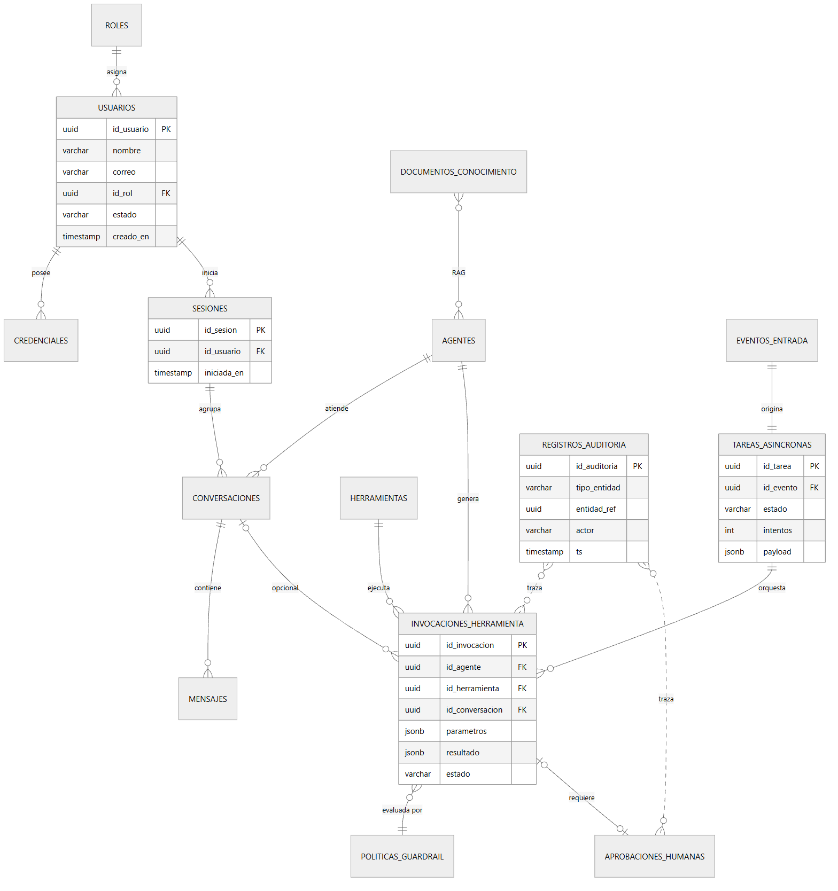

Extracto del DDL propuesto:

```sql
CREATE TABLE invocaciones_herramienta (
    id_invocacion      UUID PRIMARY KEY,
    id_agente          UUID NOT NULL REFERENCES agentes(id_agente),
    id_herramienta     UUID NOT NULL REFERENCES herramientas(id_herramienta),
    id_conversacion    UUID REFERENCES conversaciones(id_conversacion),
    parametros         JSONB NOT NULL,
    resultado          JSONB,
    estado             VARCHAR(20) NOT NULL,
    creado_en          TIMESTAMPTZ NOT NULL DEFAULT now()
);
CREATE INDEX idx_invocaciones_conversacion ON invocaciones_herramienta (id_conversacion);
```
