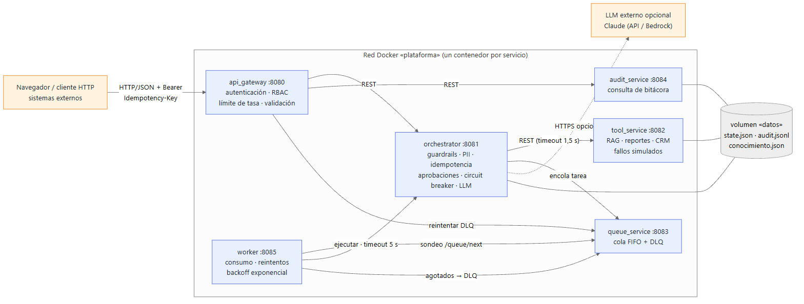

# Plataforma distribuida de agentes LLM

Proyecto final de **Sistemas Distribuidos**. Integrantes: Luis Felipe Arenas Bernal · Juan Pablo Vargas Castañeda.

Arquitectura de referencia sobre AWS (Amazon Bedrock AgentCore) y un **prototipo funcional de seis servicios** que se comunican por HTTP/JSON y una cola con DLQ. El prototipo se despliega como seis contenedores Docker e implementa:

- reintentos con backoff, circuit breaker, timeouts escalonados e idempotencia segura ante concurrencia;
- control de acceso por roles (401/403), límite de tasa (429), enmascaramiento de PII y auditoría;
- un agente con búsqueda RAG y un LLM que funciona simulado por defecto o con Claude real (API de Anthropic o Amazon Bedrock).



## Inicio rápido

```bash
# Opción A: Docker (recomendada)
docker compose up -d --build --wait
# Interfaz: http://127.0.0.1:8080/
python scripts/demo_docker.py          # demo con caída y recuperación de un nodo
docker compose down

# Opción B: procesos locales (Python 3.12+, sin dependencias)
python scripts/run_all.py

# Pruebas (con Docker y run_all detenidos)
python -m unittest discover -s tests -v   # 25 pruebas, ~30 s
```

Instrucciones completas en [MANUAL_INSTALACION.md](MANUAL_INSTALACION.md).

## Entregables

| N.º | Entregable | Ubicación |
|---|---|---|
| 1 | Documento técnico (19 secciones) | `Documento_Tecnico.docx` (fuente: `Documento_Tecnico.md`) |
| 2 | Aplicación funcional | `src/`, `Dockerfile`, `docker-compose.yml` |
| 3 | Código fuente | Este repositorio |
| 4 | Diagramas de arquitectura | `docs/arquitectura.png`, `docs/prototipo.png` y fuentes `.mmd` |
| 5 | Evidencias de pruebas | `evidencias/`, `docs/capturas/` |
| 6 | Manual de instalación y ejecución | `MANUAL_INSTALACION.md` |
| 7 | Video de sustentación | Guion en `GUION_VIDEO.md` |
| 8 | Presupuesto | `PRESUPUESTO.md` |

## Resultados principales

| Prueba | Resultado |
|---|---|
| Suite automatizada | 25/25 correctas (funcionales, integración, concurrencia, rendimiento, tolerancia a fallos) |
| Rendimiento (250 solicitudes, 25 concurrentes) | 254,9 req/s · p95 = 130 ms (requisito ≤ 500 ms) |
| 20 reintentos simultáneos con la misma clave | 1 tarea y 1 conversación (antes de la corrección: 7 y 16) |
| Caída real de `tool_service` | Los otros 5 servicios siguen operando; la tarea va a la DLQ y se recupera al reiniciar |

## Estructura

```
├── Documento_Tecnico.md / .docx   Informe técnico
├── MANUAL_INSTALACION.md          Manual
├── PRESUPUESTO.md · GUION_VIDEO.md
├── Dockerfile · docker-compose.yml
├── config/config.json             Puertos, tokens, límites, timeouts y políticas
├── data/conocimiento.json         Base de conocimiento (el estado se crea en ejecución)
├── docs/                          Diagramas (.mmd/.png) y capturas
├── evidencias/                    Resultados de pruebas, métricas y demo Docker
├── scripts/                       Arranque, demo Docker y generación de artefactos
├── src/                           Seis servicios + adaptador LLM + interfaz web
└── tests/                         25 pruebas automatizadas
```
